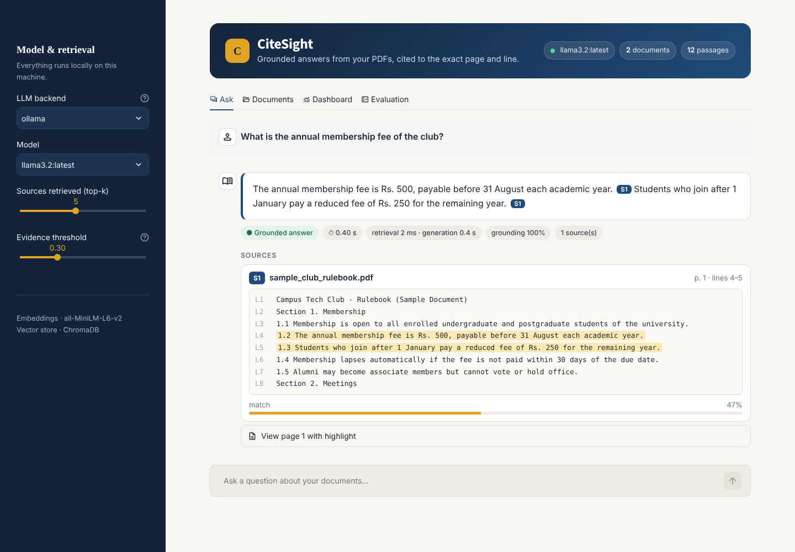
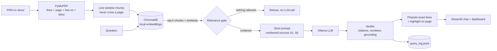

# 📑 CiteSight — Grounded RAG Assistant

**A local, source-citing document assistant that refuses to hallucinate.**
Ask questions about your own PDFs (syllabus guidelines, municipal bylaws, club rules), and every answer shows the **exact PDF, page and line number** it came from, with the line highlighted on the page. If the documents don't contain the answer, the assistant says so instead of guessing.



Everything runs on your machine: **ChromaDB** for vectors, **Ollama** for the LLM, **PyMuPDF** for PDF parsing and highlighting, **Streamlit** for the UI.

---

## ✨ Features

| | |
|---|---|
| 🎯 **Page + line citations** | Every sentence ends with `[S#]`; each source expands to show the cited lines and a rendered page with those lines highlighted. |
| 🛡️ **Anti-hallucination guards** | Relevance gate, strict prompt, citation verification, number checking (details below). |
| 🔒 **Fully local** | Ollama + local embeddings. No document leaves your laptop. An OpenAI-compatible API is optional. |
| 📊 **Latency & quality dashboard** | Retrieval vs generation latency per query, p95 latency, answer/refusal rate, grounding score. |
| 🧪 **Evaluation suite** | Retrieval hit@k, MRR, citation accuracy, refusal accuracy on unanswerable questions, keyword recall. |
| 🖥️ **CLI too** | `python cli.py ingest / ask / eval` |

## 🏗️ Architecture



### How hallucination is prevented
1. **Relevance gate**: if no retrieved chunk reaches the minimum cosine similarity, the assistant refuses *without calling the LLM*.
2. **Strict prompt**: the model sees only numbered sources (with line numbers), must cite `[S#]` on every sentence, and must reply `NOT_FOUND` if the answer isn't there. Temperature is 0.
3. **Citation verification**: citations to sources that don't exist are counted as invalid. An answer with no valid citation is **withheld** (`unverified`).
4. **Number check**: any number in the answer that doesn't appear in the cited text is flagged in the UI.
5. **Grounding score**: share of the answer's content words found in the text it cites, shown per answer and on the dashboard.
6. **Line pinpointing**: each cited chunk is narrowed to the specific line(s) that support the sentence, and those lines are highlighted on the rendered PDF page.

## 🚀 Quick start (Windows)

**1. Install prerequisites**
- [Python 3.10+](https://www.python.org/downloads/) (tick *Add to PATH*)
- [Ollama](https://ollama.com/download), then in a terminal:
  ```bash
  ollama pull llama3.2
  ```

**2. Run**
```bash
run.bat
```
This creates a virtual environment, installs dependencies, indexes `docs/`, and opens the app at http://localhost:8501.

<details><summary>Manual setup (any OS)</summary>

```bash
python -m venv .venv
.venv\Scripts\activate          # macOS/Linux: source .venv/bin/activate
pip install -r requirements.txt
python cli.py ingest            # index PDFs in docs/
streamlit run app.py
```
</details>

The first run downloads the small local embedding model (~80 MB, all-MiniLM-L6-v2) once.

## 📂 Using your own documents
- Drop PDFs into `docs/` and run `python cli.py ingest`, **or**
- Upload them in the **📂 Documents** tab of the app.

Two fictional sample PDFs (a club rulebook and course guidelines) are included so you can try it right away. Regenerate them with `python scripts/make_sample_docs.py`.

> Scanned PDFs have no text layer. Run OCR first (e.g. `ocrmypdf in.pdf out.pdf`).

## 💬 Example

> **Q:** What is the annual membership fee?
>
> **A:** The annual membership fee is Rs. 500, payable before 31 August each academic year. `S1`
>
> ▸ **S1 · sample_club_rulebook.pdf · page 1 · line 4** (cited line highlighted on the page)

> **Q:** Who won the FIFA World Cup in 2018?
>
> **A:** I couldn't find this in the indexed documents, so I won't guess.

## 🧪 Evaluation
`eval/questions.json` holds answerable questions (with the expected file and page) and unanswerable ones. Run it from the **🧪 Evaluation** tab or:

```bash
python cli.py eval
```

| Metric | Meaning |
|---|---|
| Retrieval hit@k | Expected page appears in the top-k retrieved chunks |
| MRR | Mean reciprocal rank of the expected page |
| Citation accuracy | Answer cites the expected page |
| Refusal accuracy | Unanswerable questions are correctly refused |
| Grounding | Share of answer words found in the cited text |
| Latency avg / p95 | End-to-end time per question |

Unit tests run fully offline (fake embedder + fake LLM):
```bash
pytest -q
```

## ⚙️ Configuration
All settings live in `config.py` and can be overridden with environment variables:

| Variable | Default | |
|---|---|---|
| `RAG_LLM_BACKEND` | `ollama` | `ollama` or `openai` (any OpenAI-compatible API, e.g. Groq) |
| `RAG_LLM_MODEL` | `llama3.2` | e.g. `mistral`, `qwen2.5:7b`, `gpt-4o-mini` |
| `RAG_EMBED_BACKEND` | `default` | `default` (MiniLM, ONNX on CPU) or `ollama` |
| `RAG_EMBED_MODEL` | `nomic-embed-text` | used when embed backend is `ollama` |
| `RAG_CHUNK_LINES` / `RAG_CHUNK_OVERLAP` | `8` / `2` | lines per chunk / overlap |
| `RAG_TOP_K` | `5` | chunks retrieved |
| `RAG_MIN_SIMILARITY` | `0.30` | relevance gate threshold |
| `OPENAI_BASE_URL`, `OPENAI_API_KEY` | | for the `openai` backend |

## 🗂️ Project structure
```
├── app.py                 # Streamlit UI (chat, documents, dashboard, evaluation)
├── cli.py                 # ingest / ask / eval from the terminal
├── config.py              # settings
├── rag/
│   ├── ingest.py          # PDF -> lines (page, line no, bbox) -> chunks
│   ├── store.py           # ChromaDB store + local embeddings
│   ├── indexer.py         # index files / folders
│   ├── llm.py             # Ollama / OpenAI-compatible client
│   ├── pipeline.py        # retrieve -> prompt -> generate -> verify -> pinpoint
│   ├── highlight.py       # render page PNG with cited lines highlighted
│   └── evaluation.py      # eval runner + query-log analytics
├── docs/                  # your PDFs (2 fictional samples included)
├── eval/questions.json    # evaluation set
├── scripts/make_sample_docs.py
└── tests/test_pipeline.py # offline tests
```

## 🛣️ Possible extensions
- OCR for scanned PDFs (Tesseract)
- Hybrid search (BM25 + vectors) and a cross-encoder re-ranker
- Streaming answers
- Multi-language documents

---
Built by **Suman Bhat**.
